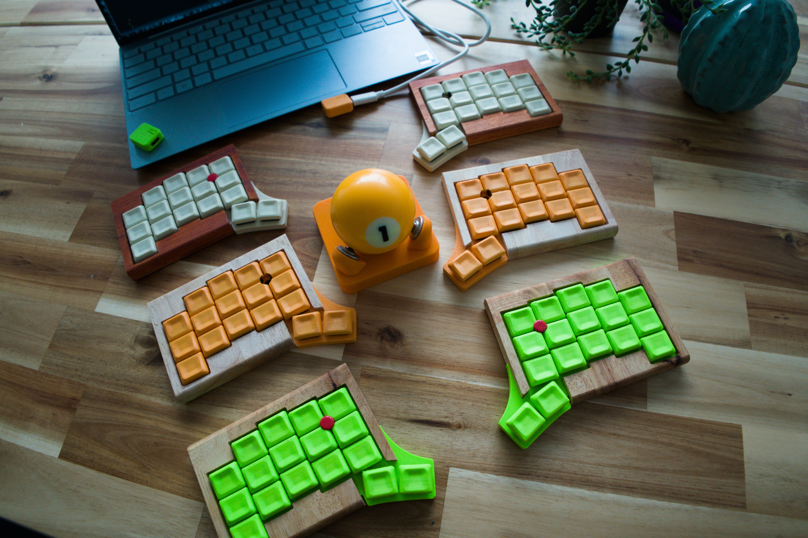

#+title: Atlas
#+options: toc:nil num:nil

[[file:images/keymap.svg]]

* Atlas

34-key split ergonomic keyboard with trackpoint. Per-half XIAO nRF52840,
BLE split, ZMK firmware, Choc V2 hotswap, 20 × 17 mm column stagger.

** Status (October 2026)

- Daily driver: breakout-board prototype, Sprintek AIO trackpoint on the
  left half. Pinned at the =proto/breakout-v1= tag.
- PCB: hotswap board ordered (5 panels, fully assembled). Each panel holds
  both halves.
- ADS1220 strain-gauge trackpoint: firmware bench-proven (HID mouse,
  radial deadzone, click-to-wake) at the =bench/ads1220= tag; on the PCB
  per half.

** Repository

| =cad/=                    | Case parts as STEP, per half: wooden housing, switch plate, bottom plate |
| =pcb/=                    | KiCad project: =atlas-left=, =atlas-right= and =atlas-panel= (both halves, as ordered) |
| =firmware/atlas20/=       | ZMK shield for the PCB (charlieplexed matrix; draft, untested) |
| =firmware/prototype-ble/= | ZMK workspace of the current breakout prototype |
| =images/=, =nix/=         | Photo, keymap drawing and the keymap-drawer setup |
| =licenses/=               | License texts, see below |

** Architecture

#+begin_example
Host <--BLE-- Left (central + trackpoint) <--BLE-- Right (peripheral)
#+end_example

** Trackpoint wiring

Sprintek SK8707 bare strain-gauge stick, read by an ADS1220 per half.
Stick up, ribbon to the left, contacts far → near:

| b | REFN0 | supply − |
| a | REFP0 | supply + (excitation current) |
| y | AIN1  | left/right output |
| x | AIN0  | away/toward output |

The right half's stick is turned 180°, so its J1 order is reversed.
Verified with a multimeter on the real stick (October 2026).

** Mouse layer

When the trackpoint moves, the mouse layer auto-activates for ~1 s after
the last movement.

#+begin_example
Thumb keys: | SCROLL | LCLK | LCLK | RCLK |
#+end_example

** Parts (per half)

| XIAO nRF52840 (Seeed 102010448)     | 1  |
| ADS1220IRVAR, VQFN-16               | 1  |
| Kailh Choc hotswap CPG135001S30     | 17 |
| 1N4148W SOD-123 diode               | 17 |
| BAW56 dual diode, SOT-23            | 5  |
| C&K PCM12SMTR power switch          | 1  |
| C&K PTS810 reset button             | 1  |
| Sprintek SK8707 trackpoint          | 1 (hand-soldered to J1) |
| 701535 LiPo cell                    | 1 (hand-soldered to BT1) |

** Previous work

- =proto/breakout-v1= — breakout-board prototype (daily driver).
- =bench/ads1220= — ADS1220 strain-gauge ADC firmware, bench-proven.
- =archive/ads1220-integration=, =archive/restore-prototype= — tips of
  earlier branches, kept as tags.

** License

- Hardware (=cad/=, =pcb/=): CERN-OHL-S-2.0
- Firmware (=firmware/=, =nix/=): GPL-3.0
- Documentation and images: CC-BY-SA-4.0

Full texts in =licenses/=.

** Links

- [[https://mwlabs.be][mwlabs.be]] — mwlabs.
